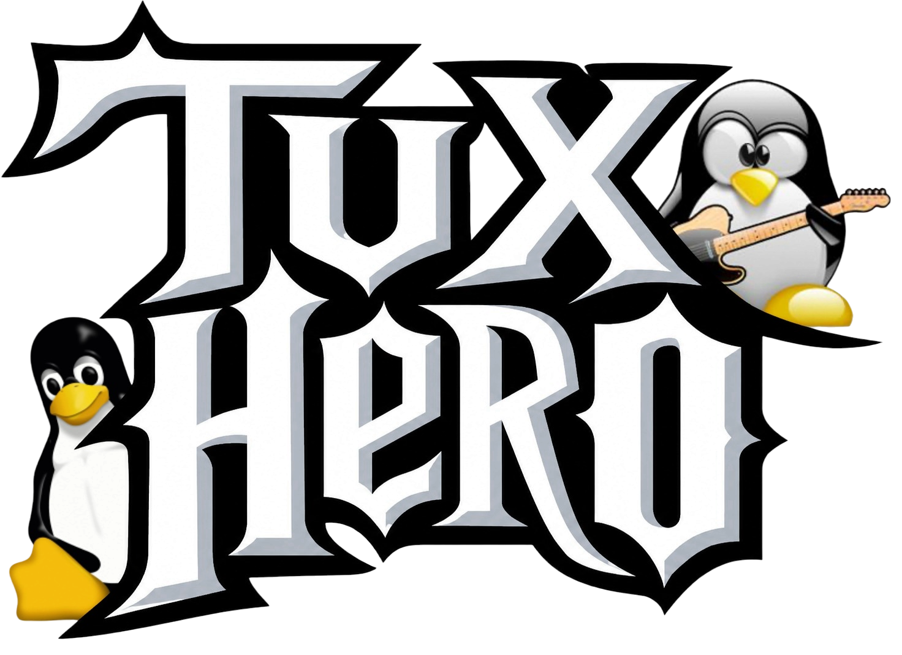

 <div align="center">



# 🎸 TUX HERO 🐧

### O ritmo do rock encontra o universo Linux.

**Um jogo musical de guitarra 3D desenvolvido para navegador, com desafios de ritmo, precisão, combos e multijogador local.**

Projeto apresentado no **Workshop IBM SkillsBuild · IBM Bob (2026)**.

### 🎮 [JOGAR TUX HERO ONLINE](https://tux-hero.vercel.app/)

[🎸 Jogar agora](https://tux-hero.vercel.app/) · [⌨️ Controles](#️-controles) · [🛠️ Tecnologias](#️-tecnologias) · [💻 GitHub](https://github.com/truemelloo/TUX-HERO)

</div>

---

## 🎮 Jogue online

O TUX HERO está publicado na Vercel e pode ser acessado diretamente pelo navegador!

**🔗 Link oficial:** https://tux-hero.vercel.app/

**💻 Código-fonte:** https://github.com/truemelloo/TUX-HERO

> Recomendado para computadores com teclado. A experiência foi desenvolvida com foco em controles físicos e renderização gráfica 3D.

## 🐧 Sobre o jogo

**TUX HERO** é um jogo musical inspirado nos clássicos jogos de guitarra, que combina a energia do rock com o universo Linux.

O objetivo é acompanhar o ritmo das músicas e acertar as notas que percorrem cinco pistas tridimensionais, pressionando as teclas correspondentes no momento certo.

Com identidade visual inspirada nos jogos musicais dos anos 2000, o projeto apresenta elementos de rock, cores roxas e lilases e a presença do **Tux, mascote do Linux**.

A experiência reúne guitarras 3D, menus temáticos, efeitos visuais, apresentações musicais, desafios de precisão e diferentes modos de jogo.

## ✨ Funcionalidades

### 🎸 Jogo rápido
Partidas musicais com cinco pistas de notas em perspectiva 3D, utilizando renderização Three.js.

### 🎵 Biblioteca de músicas
Sistema de seleção musical com informações das faixas, artistas, dificuldades e charts associados.

### 📁 Importação de músicas
Permite utilizar arquivos de áudio próprios, com recursos de análise e geração aproximada de notas. A sincronização pode variar conforme a música.

### 👥 Multijogador local
Modo para dois jogadores no mesmo computador, com guitarras independentes, controles separados e pontuação individual.

### 🏆 Pontuação e combos
Sistema de acertos, sequências, multiplicadores e resultados de desempenho.

### 🎥 Experiência audiovisual
Abertura em vídeo, cenário de show, efeitos luminosos, identidade visual personalizada e interface em português.

### ⚙️ Menus e configurações
Navegação por teclado, instruções, controles de áudio, pausa e opções de jogo.

> Alguns recursos podem apresentar diferenças de comportamento conforme o navegador, o teclado e os arquivos musicais utilizados.

## ⌨️ Controles

| Modo | Teclas | Função |
|---|---|---|
| 🎸 Jogo rápido | **A · S · D · F · G** | Acertar notas nas cinco pistas |
| 👤 Multijogador — Jogador 1 | **A · S · D · F · G** | Controlar a primeira guitarra |
| 👤 Multijogador — Jogador 2 | **J · K · L · Ç · Enter** | Controlar a segunda guitarra |
| 🎮 Menus | **↑ · ↓ · Enter** | Navegar e selecionar |
| 🎬 Abertura | **Enter / Esc** | Pular introdução |

**Observação:** o multijogador utiliza a tecla Ç e recomenda um teclado com layout brasileiro compatível.

## 🖥️ Como executar localmente

**1. Clone o repositório:**

```bash
git clone https://github.com/truemelloo/TUX-HERO.git
```

**2. Acesse a pasta:**

```bash
cd TUX-HERO
```

**3. Inicie um servidor local:**

Utilize a extensão **Live Server** do Visual Studio Code ou execute:

```bash
python -m http.server 8000
```

**4. Abra no navegador:**

```text
http://localhost:8000
```

O projeto contém arquivos JavaScript preparados para execução no navegador. Para testar a versão estática, não é necessário reconstruir o bundle com Webpack.

## 🛠️ Tecnologias

| Tecnologia | Utilização |
|---|---|
| HTML5 | Estrutura e organização das telas |
| CSS3 | Interface, menus, HUD e identidade visual |
| JavaScript | Mecânicas, controles e lógica do jogo |
| Three.js | Renderização das guitarras e pistas 3D |
| WebGL | Renderização gráfica acelerada |
| Web Audio API | Processamento e análise de áudio |
| IndexedDB | Armazenamento local de dados musicais |
| Webpack | Ferramenta presente na estrutura do projeto-base |
| GitHub | Versionamento e publicação do código |
| Vercel | Hospedagem e deploy do jogo |

## 📂 Estrutura do projeto

```text
TUX-HERO/
├── index.html
├── README.md
├── package.json
├── webpack.config.js
├── .gitignore
│
├── css/
│   └── Estilos e interface
│
├── lib/
│   ├── Lógica e mecânicas
│   └── tux-library/
│       └── Biblioteca e charts musicais
│
├── vendor/
│   └── Bibliotecas JavaScript
│
├── assets/
│   └── Imagens, vídeos e áudios
│
└── docs/
    └── Documentação do projeto
```

## 🤖 Inteligência artificial no desenvolvimento

O **TUX HERO** foi desenvolvido e personalizado com apoio de ferramentas de inteligência artificial, incluindo o **IBM Bob**, como parte das atividades relacionadas ao Workshop IBM SkillsBuild 2026.

A utilização da IA auxiliou no desenvolvimento, organização e aprimoramento do projeto, envolvendo:

- Planejamento das funcionalidades e da experiência do jogador.
- Direcionamento da identidade visual.
- Personalização de menus e componentes.
- Integração de recursos musicais e audiovisuais.
- Implementação e aprimoramento dos modos de jogo.
- Identificação e correção de problemas.
- Ajustes de interface e preparação para publicação.

O projeto utiliza e adapta componentes de uma base preexistente de jogo musical em JavaScript e Three.js, conhecida como **JS Hero**.

O objetivo da personalização foi desenvolver uma experiência com identidade própria, incorporando o universo Linux, o mascote Tux e recursos adicionais de jogabilidade.

## 🎨 Capturas de tela

Espaço reservado para imagens reais do projeto:

- Menu principal do TUX HERO.
- Guitarra 3D durante a partida.
- Biblioteca e seleção de músicas.
- Modo multijogador local.

As capturas poderão ser adicionadas futuramente à pasta `assets/prints/`.

## 👩‍💻 Autoria e evento

**Projeto:** TUX HERO

**Desenvolvimento e personalização:** Ana Clara de Souza Mello

**Evento:** Workshop IBM SkillsBuild · IBM Bob

**Ano:** 2026

**Repositório:** https://github.com/truemelloo/TUX-HERO

**Jogo online:** https://tux-hero.vercel.app/

O projeto foi apresentado como parte de uma iniciativa educacional voltada à aplicação prática de conhecimentos em desenvolvimento de software, criatividade e inteligência artificial.

## ⚖️ Créditos e direitos autorais

- **Tux:** mascote do Linux, utilizado como elemento de identidade temática, sem afiliação oficial.
- **JS Hero:** projeto-base preexistente desenvolvido com JavaScript e Three.js. As atribuições e condições de licença originais devem ser respeitadas.
- **Músicas:** as composições e gravações pertencem aos respectivos artistas, compositores, gravadoras e demais titulares de direitos.
- **Recursos audiovisuais:** imagens, vídeos e demais materiais de terceiros permanecem sujeitos às respectivas condições de uso.
- **IBM SkillsBuild e IBM Bob:** mencionados como contexto educacional e ferramentas utilizadas, sem representar endosso oficial.

A identificação dos autores e artistas não substitui as autorizações necessárias para redistribuição pública de materiais protegidos.

---

<div align="center">

### 🎸 ACERTE AS NOTAS. MANTENHA O COMBO. FAÇA O SHOW ACONTECER. 🐧

**TUX HERO © 2026 — Desenvolvimento e personalização por Ana Clara de Souza Mello**

[🎮 JOGAR ONLINE](https://tux-hero.vercel.app/) · [💻 REPOSITÓRIO GITHUB](https://github.com/truemelloo/TUX-HERO)

</div>
